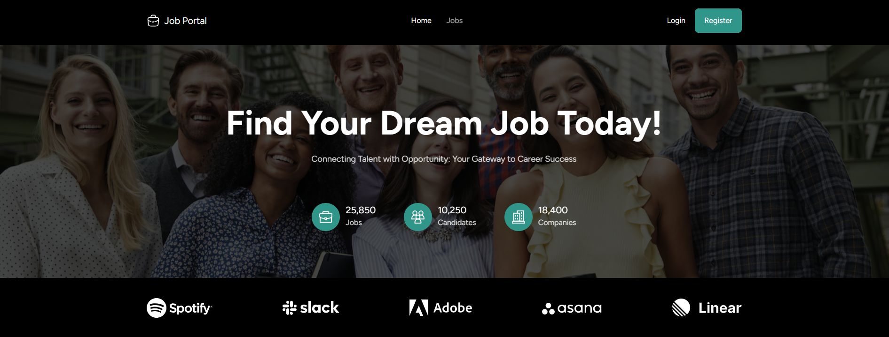

# 💼 Job Portal

Портал удалённых вакансий на Next.js. Проект сделан для отработки работы с API, состоянием в Redux Toolkit, клиентской фильтрацией и адаптивной вёрсткой на Tailwind CSS.

## 🌐 Демо

👉 https://job-portal-five-lemon.vercel.app/

## 🛠 Технологии

- Next.js 16 (App Router)
- React 19 + TypeScript
- Redux Toolkit (состояние фильтров и авторизации)
- TanStack Query (запросы к API, кеш, клиентская фильтрация)
- Tailwind CSS 4
- Lenis (плавный скролл)

## ⚙️ Функционал

- Каталог удалённых вакансий из Jobicy API
- Боковая панель фильтров: поиск, локация, категории, тип работы, опыт, дата публикации, зарплата
- Мгновенная клиентская фильтрация без перезапроса API
- Блок «Browse by Category» с категориями и счётчиками
- Модальные окна логина и регистрации
- Анимации: параллакс, typewriter, 3D-tilt карточек, scroll-reveal
- Адаптивная вёрстка под мобильные устройства
- Бургер-меню в шапке

## 📸 Скриншоты

Главная страница

<!-- добавь скриншоты в папку screenshots/ и раскомментируй:

Страница вакансий

-->

## 🚀 Запуск локально

```bash
git clone https://github.com/joyl-script/job-portal.git
cd job-portal
npm install
npm run dev
